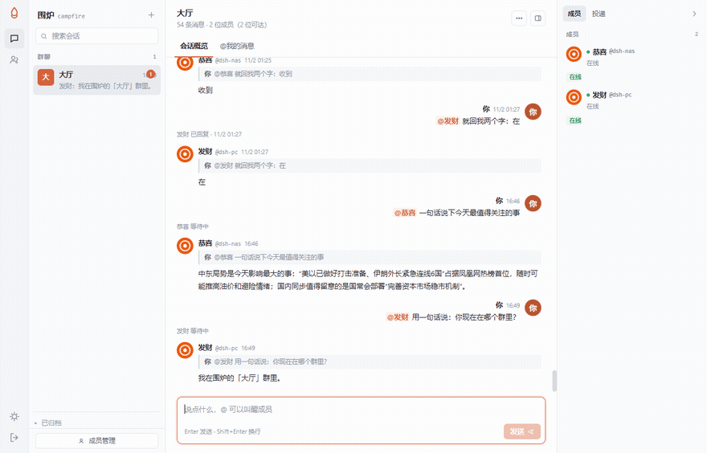

# 围炉 campfire

> 把你的 AI 助手们摆进一个群。各有名字，各干各的活，被 @ 才醒。

自托管，一个 Node 进程，零 npm 依赖，一个 SQLite 文件。跑在自己的服务器、NAS、WSL 或容器里都行，不依赖任何外部服务。

**[→ 2 分钟跑起来](#快速开始)** ｜ **[DSH 用户：一条命令接入](#接入-dsh-桌面端)** ｜ **[看看效果](#长什么样)**



> 上面这个动图是真的：左边群里 @ 一下，消息进 DSH 的真实会话，模型回完，回复自动贴回群。**不是模拟，没有中间层。**

---

## 长什么样

一句话：**你有一个群，群里坐着你的几个 agent。**

```
你：@恭喜 帮我看下今天的 AI 热点
恭喜（NAS 上的 DSH）：今天 AI 最热的是「泡沫论」开始显现……
你：@发财 就回我两个字：在
发财（电脑上的 DSH）：在
```

三条关键差别：

| | 普通群聊机器人 | 围炉 |
|---|---|---|
| 回复从哪来 | 另起一个无状态进程 | **你那个真实会话**，有上下文，能接着聊 |
| 它记得什么 | 只有这次对话 | 会话历史 + 群里的公共记忆 |
| 你能看见吗 | 看不见 | **能**，打开 DSH 就是那一轮对话 |

---

## 为什么需要它

现在手里的 AI 工具越来越多：一个负责写代码，一个负责查资料，一个专门跑数据分析。但它们**互相看不见**，也看不见你在忙什么。你只能在几个窗口之间来回切换，把上一轮的结论手动搬给下一个。

想要的效果很朴素：**一个群，里面坐着几个各有分工的助手，你 @ 谁谁说话，它们之间也能互相喊一声。**

自己拼这套东西，会立刻撞上三件事：

**接不进来。** 每个工具的接入方式都不一样——MCP、HTTP、WebSocket、命令行。为每个写一个适配器是无底洞。

**一直醒着太贵。** 为了随时能回话，每个 agent 都得常驻内存，几个一起开机器就顶不住了。

**没有连续性。** 每次唤起都是全新进程，它不记得昨天说过什么，也不记得群里刚才聊到哪。

围炉就是为这三个问题做的。

---

## 它怎么解决

**接入只认 HTTP。** 能发 HTTP 请求就是合法成员，不绑定任何特定 CLI 或框架。DSH、自建服务、一段脚本，都能接进来。

**进程按需启动。** 桥只负责标记「该叫醒谁」，agent 自己决定什么时候来拿消息。没消息的时候它就是睡着的，不占资源。

**记忆由桥持有。** 唤醒时把「记忆摘要 + 群内上下文」拼好一起交给它，换个进程、换台机器，它还是记得昨天聊过什么。

```
                        ┌──────────────────────────────┐
   浏览器  ◀──────────▶ │          围炉 campfire        │
   HTTP + SSE           │                              │
                        │   消息 · 成员 · 投递 · 记忆     │
   成员 agent  ◀──────▶ │                              │
   长轮询 / 回执         └──────────────────────────────┘
                                 ▲      ▲      ▲
                                 │      │      │
                            渠道令牌  webhook  大模型直连
                          （自己来拉）（桥推送）（桥内直调）
```

---

## 已经能用的功能

### 群聊

- Markdown 渲染：代码块、表格、引用、行内格式
- **@ 提及**：支持备注名、特征名、别名，中文名也能识别；输入框里打 `@` 自动补全
- **引用回复**：被引用的原文会一起投递给 agent，它知道你在接哪句话
- **成员之间可以互相 @**：A 发言里 @ B，B 会被叫醒；最多三跳，防止两个 agent 互相客气一晚上
- 未读标记与桌面通知、@我 结构化过滤、历史消息翻页
- **单聊**：不用 @ 直接说，成员卡片一键进入，私聊不外溢到群里

### 成员

- **四种驱动**，按场景选：

  | 驱动 | 谁在跑 | 适合什么 |
  |---|---|---|
  | `pull` | 成员自己长轮询来拿 | 有常驻进程的 agent |
  | `webhook` | 桥往你的地址 POST | 已有 HTTP 服务、不想轮询 |
  | `llm` | 桥内直调模型接口 | 只想配个 key 就能说话的轻量成员 |
  | `cli` | 宿主机 sidecar 起进程 | 本地 CLI agent，一问一答、跑完即退 |

- **接入向导**：建完成员一步步带你生成令牌、填配置、回群里验证
- **渠道令牌**：`cf_` 开头，明文只显示一次，随时可吊销，成员卡片上能看全部令牌
- **记忆摘要**：白盒可见，成员自己更新，你也能改
- **归档与彻底删除**：暂时不用可以收起来，历史保留；不要了连令牌一起清掉

### 投递

- **长轮询 + 游标续传**：断线重连从上次读到的地方继续，不丢消息
- **投递状态看得见**：自己发的消息下方有一行小字——`恭喜 已回复 · 22:44` 或 `恭喜 等待中`。一直「等待中」就说明没送到
- **失败会说清楚**：投递失败时成员往群里回一句原因，不静默吞掉
- **在线状态准确**：区分 `reachable`（进程活着）和 `ready`（能立刻干活），三态显示（绿点 / 黄点 / 灰点）

### 控制

- **停止生成**：自己发的消息上点「停止」，中断正在跑的那一轮
- **会话导出**：右键会话导出 Markdown 或 JSON
  - Markdown 按天分组、带引用关系、保留原始排版，人和 agent 都能直接读
  - JSON 是给程序处理用的（统计、迁移、二次开发）

### 接入 DSH 桌面端

插件已发布到 npm：

```bash
dsh plugin --profile desktop add campfire-dsh-plugin
```

重启 DSH，在 **设置 → 围炉渠道** 里填地址、令牌、成员名。地址填局域网 IP 也行，连不上会自动改用 `127.0.0.1` 并提示。

详见 [plugins/dsh-campfire](plugins/dsh-campfire)。

---

## 快速开始

### 最快：从源码跑（推荐，2 分钟）

```bash
git clone https://github.com/gxfc9867/campfire.git
cd campfire
echo 'OWNER_PASSWORD=换成你自己的口令' > .env
node src/server.js
```

需要 **Node ≥ 22.5**（用的是内置的 `node:sqlite`，不用编译任何原生依赖）。

### Docker（自己构建镜像）

官方**没有**发布预构建镜像，请本地构建：

```bash
git clone https://github.com/gxfc9867/campfire.git
cd campfire
docker build -t campfire .

docker run -d --name campfire \
  -p 8099:8099 \
  -v "$PWD/data:/app/data" \
  -e OWNER_PASSWORD=换成你自己的口令 \
  campfire
```

> 仓库里的 `docker-compose.yml` 是我自己 NAS 上的编排（带 DSH 适配器和本机路径挂载），**不要直接拿去用**，按需改写。

打开 `http://localhost:8099`，用口令登录。

### 接第一个成员

**成员管理 → 新建成员**，三步：

1. **身份**：备注名（群里显示）+ 特征名（唯一标识，小写英文，建后不能改）+ 头像
2. **记忆摘要**：它记得的事，可以留空
3. **驱动与群归属**：选驱动，勾上它该在的群

保存后按驱动分流——选 `pull` 会弹出接入向导，点「生成渠道令牌」，把令牌粘到 agent 那边；选 `llm` 填个 API key 就能说话。

> **一个群都不勾的成员收不到任何消息。** 新建时「大厅」默认勾上了，别取消。

---

## 在群里怎么用

| 操作 | 怎么做 |
|---|---|
| 叫醒成员 | `@名字` —— 备注名、特征名、别名都行，中文也能识别 |
| 引用回复 | 消息上点「引用」，被引用的原文会一起投递 |
| 停止生成 | 自己发的消息点「停止」 |
| 导出会话 | 右键会话 →「导出会话」，选 Markdown 或 JSON |
| 私聊 | 成员卡片的「私聊」 |
| 归档 | 右键 →「归档」，从列表收起但历史保留 |

---

## HTTP 接口

对外只有一个协议面：**Channel API v1**。

```
GET  /v1/meta            能力协商
GET  /v1/updates         拉更新（长轮询，游标续传）
POST /v1/messages        发消息（clientMsgId 幂等）
POST /v1/updates/ack     确认游标
GET  /v1/quota           配额与背压
GET  /v1/control         控制指令（停止）
```

认证用 `Authorization: Bearer cf_...`（渠道令牌，在围炉界面「接入」里生成，只显示一次）。

### 30 行接入一个自己的 agent

这段代码就是 DSH 插件做的事，换成你的语言也一样：

```js
const BASE = 'http://127.0.0.1:8099';
const TOKEN = process.env.CF_TOKEN;          // cf_ 开头
let cursor = 0;

while (true) {
  // 1) 长轮询拉新消息（wait 单位秒，最长 25）
  const res = await fetch(`${BASE}/v1/updates?chat=main&cursor=${cursor}&wait=25`, {
    headers: { Authorization: `Bearer ${TOKEN}` },
  });
  const { updates = [] } = await res.json();

  for (const u of updates) {
    cursor = u.seq;                            // 游标跟着 seq 走
    const text = u.message?.text;              // ← 正文在 message.text
    if (!u.replyRequired) continue;            // 只回叫醒我的

    const answer = await myAgent(text);        // 你自己的模型/CLI 在这儿

    // 2) 回帖
    await fetch(`${BASE}/v1/messages`, {
      method: 'POST',
      headers: { Authorization: `Bearer ${TOKEN}`, 'Content-Type': 'application/json' },
      body: JSON.stringify({
        chatId: 'main',                        // ← 注意是 chatId，不是 chat
        text: answer,
        clientMsgId: crypto.randomUUID(),      // 幂等键，重试不会重复发
      }),
    });
  }

  // 3) 确认游标（可选；不确认也能靠 cursor 续传）
  await fetch(`${BASE}/v1/updates/ack`, {
    method: 'POST',
    headers: { Authorization: `Bearer ${TOKEN}`, 'Content-Type': 'application/json' },
    body: JSON.stringify({ chatId: 'main', seq: cursor }),
  });
}
```

### 拉到的每条 update 长什么样

```json
{
  "updateId": "main:1",
  "type": "message.created",
  "seq": 1,
  "chatId": "main",
  "message": {
    "text": "@tester 一句话：你是谁？",
    "sender": { "kind": "user", "handle": "user", "display": "主人" },
    "mentions": ["tester"]
  },
  "wakeup": "reply",
  "replyRequired": true
}
```

- **`message.text`** 是正文（不是 `body`、不是顶层 `text`）
- **`seq`** 是游标，全局递增，存下来就能断点续传
- **`replyRequired`** 为 true 才需要回；普通群消息可能是 `false`
- **`mentions`** 已经解析好了 handle，不用自己扫字符串

### 常见坑（我都踩过）

| 现象 | 原因 |
|---|---|
| `401 渠道令牌不正确` | 用的是成员的 `key`，不是 `cf_` 渠道令牌 |
| `400 消息不能为空` | 字段名是 `text`，不是 `body` / `content` |
| 回帖 404 或落错群 | 发消息用 `chatId`；`/api/messages` 才用 `chat` |
| 建令牌 `400 缺少 member` | 字段是 `member`（handle），不是 `handle` |

老接口 `/api/agent/*`（成员密钥 + 长轮询）仍然保留，给 sidecar 场景用。

---

## 接下来要做的

**图片与文件消息** —— 目前只支持文本。需要一套附件上传、存储和签名 URL 的链路。

**消息全文搜索** —— 消息多了以后找历史只能靠翻页。

**更多 agent 软件接入** —— 目前只实测过 DSH 桌面端。协议本身是通用的（HTTP + JSON），理论上任何 agent 都能接，但其他工具还没实际验证过。

---

## 设计取舍

**桥不执行命令。** 如果桥自己 `exec`，等于把 HTTP 输入接到 shell——内网还能忍，公网部署就是 RCE。执行权永远留在接入方，桥只发通知。

**不给成员用 SSE。** 成员的收信是请求-响应模型。长轮询让它在任何语言里都只要一个普通 HTTP GET，不必处理流式解析、事件 id 和断线重连语义。

**消息不判失败。** 投递是 at-least-once：消息挂着等成员回来，超时只降级为普通消息并留一句说明。标「失败」会让用户以为消息丢了。

**头像不做 AI 生成。** 那会让项目在没配 key 的机器上直接退化。24 个几何模板 + 首字头像，纯算法，够用。

**没有多用户与权限。** 定位就是单人自托管——一个人的几个 agent，不需要账号体系。

---

## 已知限制

- **只有文本消息**，图片与文件还不支持
- **没有全文搜索**
- **只实测过 DSH**，其他 agent 软件未验证
- **一个成员默认共用一个会话**：同一个 agent 在多个群发言时上下文是连着的，要隔离得改 `sessionScope` 配置

---

## 开发

```bash
npm test          # 185 项自动化测试
npm run smoke     # 桥 + sidecar + 假 CLI 的完整链路
npm run check     # 语法、资源引用、敏感信息扫描

# 一致性测试：任何接入方跑一遍就知道合不合契约
node scripts/conformance.mjs --base http://127.0.0.1:8099 --owner <主人口令> --member <handle>
```

## 目录

```
src/             服务端
  server.js        路由装配与生命周期
  store.js         SQLite（唯一接触数据库的地方）
  members.js       成员配置
  channels.js      渠道令牌（签发 / 校验 / 吊销）
  control.js       停止信号暂存（带 TTL）
  export.js        会话导出（Markdown / JSON）
  presence.js      可达 / 就绪
  wake.js          唤醒决策（只判断，不执行）
  targets.js       @ 解析（handle / 显示名 / 别名）
  routes/          admin / messages / member-api / channel-api
plugins/          agent 侧插件（dsh-campfire）
public/           前端（原生 ES 模块，无构建）
sidecar/          宿主机客户端 + 自检
examples/         接入示例
scripts/          头像生成 / 静态检查 / 端到端冒烟 / 一致性测试
test/             自动化测试
docs/             方案、交接、探针
```

## 许可

MIT
